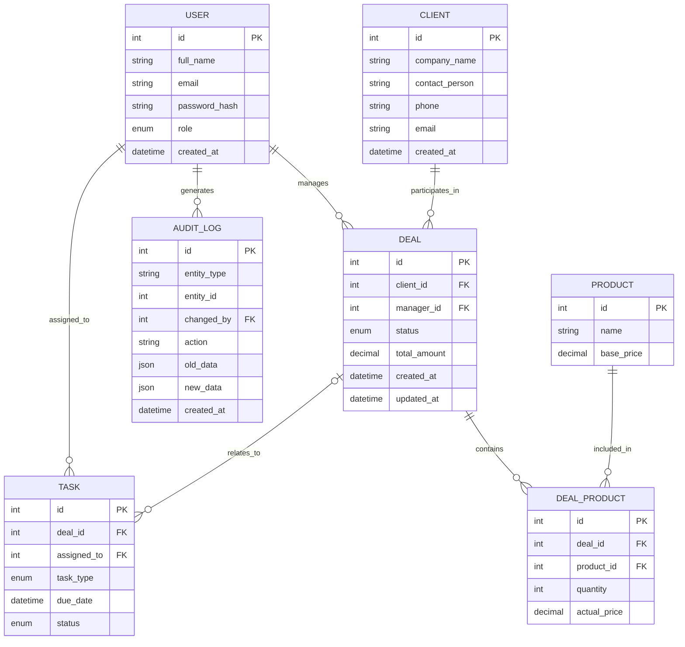

# OpenCRM

## Домен

OpenCRM – система управління взаємовідносинами з клієнтами (CRM), призначена для автоматизації процесів відділу продажів та оптимізації роботи менеджерів із клієнтською базою. Платформа забезпечує централізоване ведення обліку клієнтів (компаній-контрагентів та контактних осіб), відстеження життєвого циклу угод через багаторівневу воронку продажів, управління каталогом товарів і послуг із можливістю гнучкої фіксації індивідуальних цін на момент укладання угоди, планування та моніторинг виконання оперативних завдань співробітників (дзвінки, зустрічі, листування), а також комплексний журнал аудиту змін даних для забезпечення прозорості та інформаційної безпеки.

## Короткий виклад вимог

### Потреби зацікавлених сторін

* **Менеджери з продажу:** потребують єдиного простору для швидкого пошуку контактної інформації клієнтів, ведення історії взаємодії, створення нових угод із додаванням необхідних товарів/послуг за узгодженими цінами, а також зручного планувальника завдань із контролем дедлайнів.
* **Керівники відділів продажів:** зацікавлені у прозорому моніторингу воронки продажів на кожному етапі, аналізі загального фінансового обсягу угод, контролі своєчасності виконання завдань підлеглими менеджерами та оцінці ефективності співробітників.
* **Адміністратори та спеціалісти з безпеки:** вимагають розмежування прав доступу на основі ролей (адміністратор, менеджер), контролю цілісності інформації, неможливості випадкового видалення пов'язаних фінансових даних та наявності незмінного журналу аудиту (audit logs) для відстеження авторства та історії змін критичних об'єктів системи.

### Дані для зберігання

* **Облікові записи користувачів (співробітників):** повне ім'я, унікальний корпоративний email, хеш пароля, роль у системі (`admin`, `manager`), часова мітка створення.
* **Клієнтська база (контрагенти):** назва компанії, контактна особа, номер телефону, email, часова мітка внесення до системи.
* **Угоди (воронка продажів):** посилання на клієнта, посилання на відповідального менеджера, поточний статус угоди, розрахункова загальна сума угоди, часові мітки створення та оновлення.
* **Довідник товарів і послуг:** назва позиції, базова вартість за прейскурантом.
* **Товари в угоді (склад замовлення):** посилання на угоду, посилання на товар, кількість одиниць товару, фактична ціна продажу на момент включення позиції в угоду.
* **Завдання менеджерів:** посилання на угоду (опціонально), виконавець (співробітник), тип активності (`call`, `meeting`, `email`), дата та час дедлайну, статус виконання (`pending`, `completed`).
* **Журнал аудиту:** тип сутності, ідентифікатор цільового запису, виконавець зміни, виконана дія (`CREATE`, `UPDATE_STATUS`, `UPDATE_DATA`, `DELETE`), зліпок попереднього стану (`old_data`), зліпок нового стану (`new_data`), точний час фіксації події.

### Бізнес-правила

* Кожна угода обов'язково закріплюється за одним клієнтом і саме за одним відповідальним менеджером зі штату користувачів.
* Зв'язок між угодами (`Deal`) та товарами (`Product`) є зв'язком «багато-до-багатьох» (M:N) та реалізується через асоціативну сутність `DealProduct`.
* Сутність `DealProduct` обов'язково фіксує фактичну ціну продажу (`actual_price`) на момент включення товару до угоди. Подальша зміна базової вартості (`base_price`) у довіднику `Product` не повинна ретроспективно змінювати вартість позицій у вже створених або завершених угодах.
* Кількість товару в позиції угоди (`quantity`) є строго додатним цілим числом (`quantity > 0`), а ціни — невід'ємними значеннями (`actual_price >= 0`, `base_price >= 0`).
* Загальна вартість угоди (`total_amount`) формується як сума вартостей усіх її позицій: $\sum (\text{quantity} \times \text{actual\_price})$.
* Завдання (`Task`) обов'язково призначається конкретному користувачеві (`assigned_to`). Завдання може стосуватися певної угоди (`deal_id`), але також може створюватися без прив'язки до жодної угоди (наприклад, первинний холодний дзвінок новому потенційному ліду чи внутрішня нарада).
* Статус угоди змінюється відповідно до встановлених етапів воронки: `new` (нова) $\rightarrow$ `negotiation` (переговори) $\rightarrow$ `contract` (узгодження договору) $\rightarrow$ `won` (успішно реалізована) або `lost` (програна/скасована).
* Журнал аудиту (`AuditLog`) працює виключно в режимі додавання записів (append-only): користувачі та співробітники не мають прав на ручне редагування чи видалення записів журналу аудиту.
* Видалення користувача або клієнта, які мають активні або історичні угоди, заборонено обмеженнями цілісності зовнішніх ключів (RESTRICT), щоб запобігти спотворенню фінансової звітності.

## Діаграма ER

## Список сутностей

* User
  * int id PK
  * string full_name
  * string email
  * string password_hash
  * enum role
  * datetime created_at
* Client
  * int id PK
  * string company_name
  * string contact_person
  * string phone
  * string email
  * datetime created_at
* Deal
  * int id PK
  * int client_id FK
  * int manager_id FK
  * enum status
  * decimal total_amount
  * datetime created_at
  * datetime updated_at
* Product
  * int id PK
  * string name
  * decimal base_price
* DealProduct
  * int id PK
  * int deal_id FK
  * int product_id FK
  * int quantity
  * decimal actual_price
* Task
  * int id PK
  * int deal_id FK
  * int assigned_to FK
  * enum task_type
  * datetime due_date
  * enum status
* AuditLog
  * int id PK
  * string entity_type
  * int entity_id
  * int changed_by FK
  * string action
  * json old_data
  * json new_data
  * datetime created_at

## Список зв’язків

* User веде нуль, одну або кілька Deal. Кожна Deal ведеться саме одним User (відповідальним менеджером).
* Client бере участь у нулі, одній або кількох Deal. Кожна Deal укладається саме з одним Client.
* Deal містить нуль, одну або багато позицій DealProduct. Кожна позиція DealProduct належить саме одній Deal.
* Product може бути включений як позиція до нуля, одного або багатьох DealProduct. Кожен запис DealProduct посилається саме на один Product. (Угоди Deal та товари Product знаходяться у зв'язку «багато-до-багатьох» через асоціативну сутність DealProduct).
* User виконує нуль, одне або кілька Task. Кожне Task призначене для виконання саме одному User.
* Deal може бути пов'язана з нулем, одним або кількома Task. Task може стосуватися саме однієї Deal або не мати прив'язки до угоди (значення deal_id є NULL).
* User генерує нуль, один або кілька записів AuditLog під час виконання операцій у системі. Кожен запис AuditLog зафіксований за саме одним User.

## Припущення та обмеження

* Концептуальна модель відповідає вимогам 3-ї нормальної форми (3НФ) та орієнтована на фізичну реалізацію в реляційній СУБД PostgreSQL.
* Самостійна онлайн-реєстрація клієнтів у системі не передбачена; усі клієнти та контрагенти вносяться до бази виключно авторизованими менеджерами.
* Автентифікація користувачів здійснюється внутрішніми засобами за допомогою безпечного хешування паролів (bcrypt/argon2); сторонні OAuth-провайдери на даному етапі не інтегруються.
* Усі розрахунки ведуться в єдиній базовій валюті (підтримка мультивалютності не вимагається поточною бізнес-моделлю).
* Зміна каталожної базової вартості товару в `Product.base_price` не змінює історичні значення `DealProduct.actual_price` у раніше створених угодах.
* Поле `deal_id` у сутності `Task` є необов'язковим (nullable), що дозволяє планувати позаугодові робочі активності менеджера.
* Дані змін попереднього та нового стану в журналі `AuditLog` (`old_data`, `new_data`) зберігаються у форматі напівструктурованого документа JSON (JSONB у PostgreSQL), що забезпечує універсальність аудиту без роздування кількості специфічних таблиць історії.
* Довідник `Product` може містити як фізичні товари, так і послуги чи сервісні пакети.
