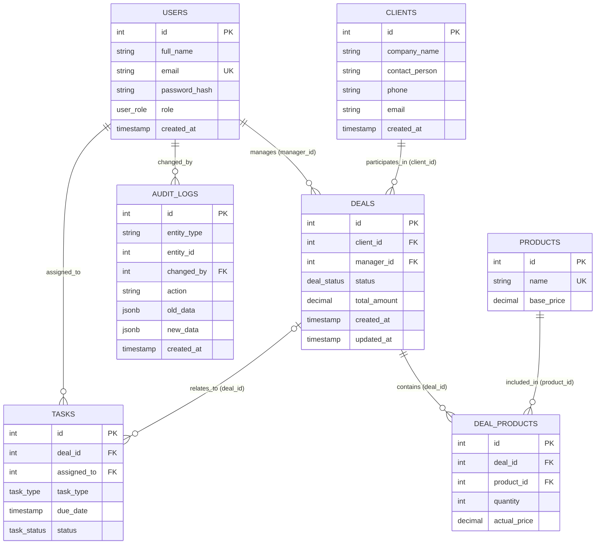

# Лабораторна робота №2: Перетворення ER-діаграми на реляційну схему PostgreSQL

**Дисципліна:** Бази даних (КПІ)  
**Предметна область:** OpenCRM (Система управління взаємовідносинами з клієнтами)  
**Автор проєкту:** Рубан Олексій  
**Команда проєкту:**  
- Рубан Олексій (Tech Lead / Admin)  
- Віталій Гладченко (Sales Manager)  
- Симоненко Поліна (Sales Manager)  
- Грищенко Ілля (Sales Manager)  

---

## 1. Мета роботи
- Практичне перетворення концептуальної ER-моделі предметної області OpenCRM (розробленої в Лабораторній роботі №1) у фізичну реляційну схему СУБД PostgreSQL.
- Написання оптимізованих інструкцій DDL (`CREATE TYPE`, `CREATE TABLE`, `CREATE INDEX`, `COMMENT ON`).
- Реалізація механізмів декларативної цілісності даних: первинних ключів (`PRIMARY KEY`), зовнішніх ключів (`FOREIGN KEY`) з відповідними політиками видалення (`ON DELETE RESTRICT / CASCADE / SET NULL`), обмежень унікальності (`UNIQUE`), обов'язковості (`NOT NULL`), перевірки значень (`CHECK`) та значень за замовчуванням (`DEFAULT`).
- Наповнення бази валідними репрезентативними тестовими даними (DML, `INSERT INTO`) для підтвердження узгодженості моделі.
- Верифікація схеми за допомогою контрольних SQL-запитів із перевіркою коректності зв'язків та обчислюваних агрегатів.

---

## 2. Діаграма реляційної схеми




---

## 3. Детальний опис реляційної схеми

### 3.1. Користувацькі перелічувані типи (ENUM)
Для підвищення строгості типізації, економії дискового простору та виключення помилок у ключових бізнес-полях створено 4 типи `ENUM`:
- `user_role`: `'admin'`, `'manager'` — роль співробітника в системі.
- `deal_status`: `'new'`, `'negotiation'`, `'contract'`, `'won'`, `'lost'` — етапи воронки продажів.
- `task_type`: `'call'`, `'meeting'`, `'email'` — види активностей менеджерів.
- `task_status`: `'pending'`, `'completed'` — статус виконання оперативних завдань.

---

### 3.2. Таблиці бази даних

#### 1. `users` (Співробітники та менеджери системи)
Зберігає облікові записи персоналу компанії, який працює в CRM.
- `id` (`SERIAL PRIMARY KEY`): унікальний числовий ідентифікатор користувача.
- `full_name` (`VARCHAR(255) NOT NULL`): ПІБ співробітника.
- `email` (`VARCHAR(255) NOT NULL UNIQUE`): корпоративна електронна пошта (додатково обмежена `CHECK (email LIKE '%@%.%')`).
- `password_hash` (`VARCHAR(255) NOT NULL`): хеш пароля доступу.
- `role` (`user_role NOT NULL DEFAULT 'manager'`): роль у системі з типовим значенням `'manager'`.
- `created_at` (`TIMESTAMP WITH TIME ZONE NOT NULL DEFAULT CURRENT_TIMESTAMP`): дата і час створення запису.

#### 2. `clients` (Клієнтська база / Контрагенти)
Зберігає відомості про юридичних осіб або ключових клієнтів.
- `id` (`SERIAL PRIMARY KEY`): сурогатний ідентифікатор клієнта.
- `company_name` (`VARCHAR(255) NOT NULL`): офіційна назва організації.
- `contact_person` (`VARCHAR(255) NOT NULL`): ПІБ контактної особи.
- `phone` (`VARCHAR(50) NOT NULL`): контактний телефон.
- `email` (`VARCHAR(255) NOT NULL`): електронна адреса (з перевіркою формату).
- `created_at` (`TIMESTAMP WITH TIME ZONE NOT NULL DEFAULT CURRENT_TIMESTAMP`): фіксація моменту внесення контрагента.

#### 3. `products` (Каталог товарів та сервісних послуг)
Довідник комерційних пропозицій компанії.
- `id` (`SERIAL PRIMARY KEY`): ідентифікатор товарної позиції.
- `name` (`VARCHAR(255) NOT NULL UNIQUE`): найменування товару або послуги.
- `base_price` (`DECIMAL(12, 2) NOT NULL CHECK (base_price >= 0)`): базова прайсова ціна (не може бути від'ємною).

#### 4. `deals` (Угоди воронки продажів)
Центральна операційна таблиця воронки продажів.
- `id` (`SERIAL PRIMARY KEY`): номер угоди.
- `client_id` (`INT NOT NULL REFERENCES clients(id) ON DELETE RESTRICT`): посилання на клієнта (заборонено видалення клієнта при наявності угод).
- `manager_id` (`INT NOT NULL REFERENCES users(id) ON DELETE RESTRICT`): посилання на відповідального менеджера.
- `status` (`deal_status NOT NULL DEFAULT 'new'`): поточний стан угоди у воронці.
- `total_amount` (`DECIMAL(12, 2) NOT NULL DEFAULT 0.00 CHECK (total_amount >= 0)`): сумарний бюджет угоди.
- `created_at`, `updated_at` (`TIMESTAMP WITH TIME ZONE NOT NULL DEFAULT CURRENT_TIMESTAMP`): аудиторські часові мітки.
- **Індекси:** `idx_deals_client_id`, `idx_deals_manager_id`, `idx_deals_status` для швидкого пошуку та фільтрації по воронці.

#### 5. `deal_products` (Склад позицій угоди — зв'язок M:N)
Асоціативна таблиця зв'язку багато-до-багатьох між угодами та товарами.
- `id` (`SERIAL PRIMARY KEY`): сурогатний ключ позиції.
- `deal_id` (`INT NOT NULL REFERENCES deals(id) ON DELETE CASCADE`): прив'язка до угоди. При видаленні угоди всі її рядки замовлення видаляються автоматично.
- `product_id` (`INT NOT NULL REFERENCES products(id) ON DELETE RESTRICT`): прив'язка до каталогу товарів (заборонено видалення товару, який фігурує в угодах).
- `quantity` (`INT NOT NULL CHECK (quantity > 0)`): кількість одиниць (строго більше 0).
- `actual_price` (`DECIMAL(12, 2) NOT NULL CHECK (actual_price >= 0)`): фактична ціна реалізації на момент оформлення угоди (ізолює угоду від подальших змін у прайсі).
- **Обмеження:** `CONSTRAINT uq_deal_product UNIQUE (deal_id, product_id)` — товар не може дублюватися всередині однієї угоди кількома рядками.

#### 6. `tasks` (Оперативні завдання співробітників)
Планувальник дій менеджерів (дзвінки, зустрічі, відправка листів).
- `id` (`SERIAL PRIMARY KEY`): ідентифікатор завдання.
- `deal_id` (`INT REFERENCES deals(id) ON DELETE SET NULL`): опціональне посилання на угоду. У разі видалення угоди завдання зберігається, а поле занулюється.
- `assigned_to` (`INT NOT NULL REFERENCES users(id) ON DELETE RESTRICT`): виконавець завдання (співробітник компанії).
- `task_type` (`task_type NOT NULL`): тип дії (`call`, `meeting`, `email`).
- `due_date` (`TIMESTAMP WITH TIME ZONE NOT NULL`): запланований дедлайн.
- `status` (`task_status NOT NULL DEFAULT 'pending'`): стан виконання.

#### 7. `audit_logs` (Незмінний журнал аудиту змін)
Append-only реєстр фіксації історії модифікації бізнес-об'єктів.
- `id` (`SERIAL PRIMARY KEY`): порядковий номер події аудиту.
- `entity_type` (`VARCHAR(50) NOT NULL`): назва сутності (`deal`, `task`, `client` тощо).
- `entity_id` (`INT NOT NULL`): ідентифікатор зміненого об'єкта.
- `changed_by` (`INT NOT NULL REFERENCES users(id) ON DELETE RESTRICT`): співробітник, який виконав дію.
- `action` (`VARCHAR(50) NOT NULL`): тип операції (`CREATE`, `UPDATE_STATUS`, `UPDATE_DATA`, `DELETE`).
- `old_data` (`JSONB`): стан даних до зміни у форматі JSON.
- `new_data` (`JSONB`): новий стан даних.
- `created_at` (`TIMESTAMP WITH TIME ZONE NOT NULL DEFAULT CURRENT_TIMESTAMP`): точний час здійснення операції.

---

## 4. Обґрунтування обмежень та політик цілісності

| Обмеження | Де застосовано | Призначення та бізнес-обґрунтування |
|---|---|---|
| `ON DELETE RESTRICT` | `deals.client_id`, `deals.manager_id`, `tasks.assigned_to`, `audit_logs.changed_by` | Захист фінансової звітності та історії від каскадного знищення при спробі видалити клієнта або користувача. |
| `ON DELETE CASCADE` | `deal_products.deal_id` | Позиції замовлення існують виключно в контексті угоди; видалення угоди автоматично очищує її склад. |
| `ON DELETE SET NULL` | `tasks.deal_id` | Завдання менеджера (наприклад, контакт чи замітка) зберігає цінність навіть у разі скасування чи видалення пов'язаної угоди. |
| `UNIQUE` | `users.email`, `products.name`, `(deal_id, product_id)` | Запобігає дублюванню облікових записів, найменувань товарів у каталозі та дублюванню однієї товарної позиції в одній угоді. |
| `CHECK (> 0 / >= 0)` | `quantity`, `base_price`, `actual_price`, `total_amount` | Виключає логічні помилки (від'ємні грошові суми, нульові або від'ємні кількості товару). |
| `CHECK (LIKE '%@%.%')` | `users.email`, `clients.email` | Гарантує мінімальну валідність формату збережених адрес електронної пошти. |

---

## 5. Тестовий набір даних (DML)

Усі дані згенеровані відповідно до реальних бізнес-сценаріїв OpenCRM із використанням імен членів навчальної команди:

* **Команда користувачів (`users`):**
  1. `Рубан Олексій` (`oleksii.ruban@opencrm.ua`) — `admin`
  2. `Віталій Гладченко` (`vitalii.hladchenko@opencrm.ua`) — `manager`
  3. `Симоненко Поліна` (`polina.symonenko@opencrm.ua`) — `manager`
  4. `Грищенко Ілля` (`illia.hryshchenko@opencrm.ua`) — `manager`
  5. `Андрій Ковальчук` (`andrii.kovalchuk@opencrm.ua`) — `manager`

* **Клієнти (`clients`):** реальні представники українського бізнесу:
  1. ТОВ «Нова Пошта Технолоджі» (контакт: Мельник Тарас Григорович)
  2. ПрАТ «Київстар Дігітал» (контакт: Шевченко Олена Вікторівна)
  3. ТОВ «Розетка Маркетплейс» (контакт: Коваленко Богдан Ігорович)
  4. ПП «Агро-Експорт Груп» (контакт: Бондаренко Ірина Сергіївна)
  5. ТОВ «Фармак Інновації» (контакт: Кравченко Максим Юрійович)

* **Угоди та позиції:**
  - 5 угод на різних стадіях воронки (`won`, `contract`, `negotiation`, `new`, `lost`).
  - Розраховані загальні суми угод повністю збігаються з сумами фактичних вартостей доданих товарних позицій:
    $$\sum (\text{quantity} \times \text{actual\_price}) = \text{total\_amount}$$

---

## 6. Верифікація схеми та контрольні SQL-запити

### 6.1. Перевірка таблиць та кількості записів
```sql
SELECT 
    schemaname, 
    relname AS table_name, 
    n_live_tup AS row_count
FROM pg_stat_user_tables
ORDER BY relname;
```

**Результат виконання:**
```text
 schemaname |  table_name   | row_count 
------------+---------------+-----------
 public     | audit_logs    |         5
 public     | clients       |         5
 public     | deal_products |        11
 public     | deals         |         5
 public     | products      |         6
 public     | tasks         |         6
 public     | users         |         5
```

---

### 6.2. Перевірка цілісності зв'язків угод, клієнтів та менеджерів
```sql
SELECT 
    d.id AS deal_id,
    c.company_name,
    u.full_name AS manager,
    d.status,
    d.total_amount
FROM deals d
JOIN clients c ON d.client_id = c.id
JOIN users u ON d.manager_id = u.id
ORDER BY d.id;
```

**Результат виконання:**
```text
 deal_id |        company_name         |      manager      |   status    | total_amount 
---------+-----------------------------+-------------------+-------------+--------------
       1 | ТОВ «Нова Пошта Технолоджі» | Рубан Олексій     | won         |     55000.00
       2 | ПрАТ «Київстар Дігітал»     | Віталій Гладченко | contract    |     71000.00
       3 | ТОВ «Розетка Маркетплейс»   | Симоненко Поліна  | negotiation |     43000.00
       4 | ПП «Агро-Експорт Груп»      | Грищенко Ілля     | new         |     35000.00
       5 | ТОВ «Фармак Інновації»      | Віталій Гладченко | lost        |     25000.00
```

---

### 6.3. Перевірка фінансової узгодженості сум угод та складу позицій
```sql
SELECT 
    d.id AS deal_id,
    d.total_amount AS deal_total,
    SUM(dp.quantity * dp.actual_price) AS calculated_items_total,
    CASE 
        WHEN d.total_amount = SUM(dp.quantity * dp.actual_price) THEN 'УЗГОДЖЕНО'
        ELSE 'РОЗБІЖНІСТЬ'
    END AS status_check
FROM deals d
JOIN deal_products dp ON d.id = dp.deal_id
GROUP BY d.id, d.total_amount
ORDER BY d.id;
```

**Результат виконання:**
```text
 deal_id | deal_total | calculated_items_total | status_check 
---------+------------+------------------------+--------------
       1 |   55000.00 |               55000.00 | УЗГОДЖЕНО
       2 |   71000.00 |               71000.00 | УЗГОДЖЕНО
       3 |   43000.00 |               43000.00 | УЗГОДЖЕНО
       4 |   35000.00 |               35000.00 | УЗГОДЖЕНО
       5 |   25000.00 |               25000.00 | УЗГОДЖЕНО
```

---

## 7. Файлова структура роботи

- [`Lab 2/schema.sql`](schema.sql) — DDL-скрипт створення типів даних, таблиць, обмежень цілісності та індексів.
- [`Lab 2/data.sql`](data.sql) — DML-скрипт наповнення бази валідними тестовими даними.
- [`Lab 2/setup.sql`](setup.sql) — об'єднаний скрипт для швидкого розгортання схеми та заповнення бази даних у клієнті pgAdmin або `psql`.
- [`Lab 2/Spec.md`](Spec.md) — повний технічний звіт та опис лабораторної роботи.
- [`Lab 2/erDiagram.png`](erDiagram.png) — діаграма сутностей і зв'язків.

---

## 8. Висновки
У ході лабораторної роботи №2 conceptual-модель ER системи OpenCRM була повністю перетворена на реляційну схему в середовищі PostgreSQL 17+. Реалізовано 7 реляційних таблиць, 4 перелічуваних типи, первинні та зовнішні ключі з політиками цілісності (`RESTRICT`, `CASCADE`, `SET NULL`), перевірочні обмеження (`CHECK`), обмеження унікальності (`UNIQUE`), індекси та змістовні коментарі. Тестовий набір даних успішно завантажено без порушень обмежень, а контрольні перевірочні запити підтвердили 100% узгодженість фінансових даних та структури зв'язків.
